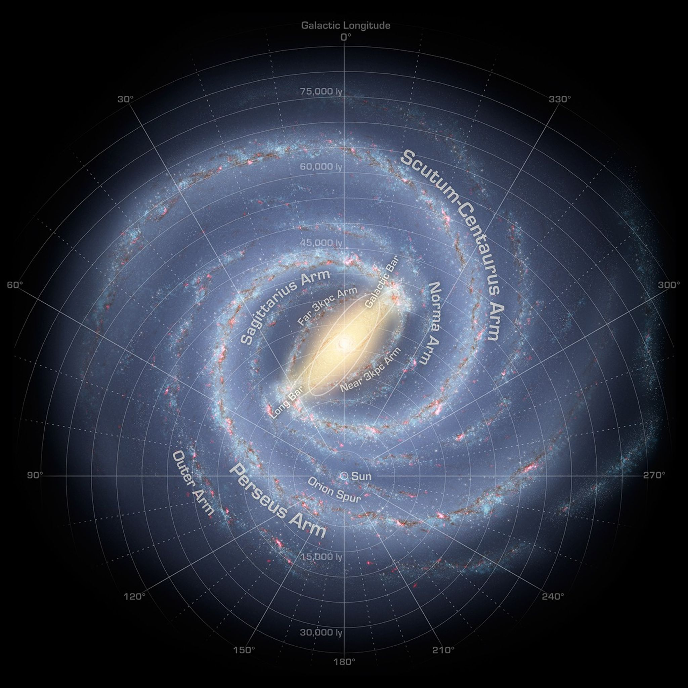
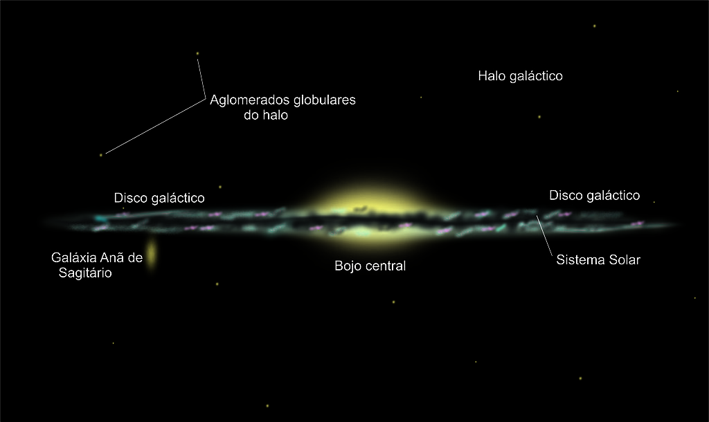
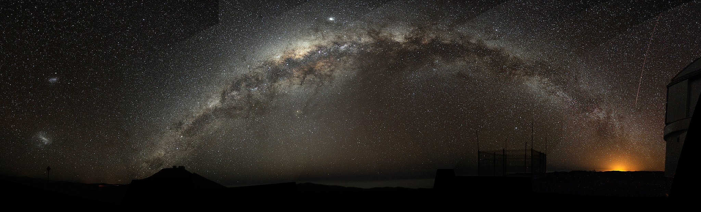

# A Via Láctea e a Nossa Posição Nela

## Via Láctea

A Via Láctea é a galáxia na qual o nosso sistema solar se encontra. 

Ela é classificada como espiral com barra, ou seja, em seu centro há uma barra alongada de estrelas, e os braços espirais se estendem a partir das extremidades dessa barra pelo disco galáctico. No seu centro está localizado o buraco negro supermassivo Sagitário A*, na direção da constelação de Sagitário.

A idade da Via Láctea é estimada por volta de 13 bilhões de anos. Ela possui um diâmetro do disco de cerca de 100 mil anos-luz, espessura de poucos milhares de anos-luz e algo entre 100 e 400 bilhões de estrelas.

Ilustração artística da Via Láctea com identificação das suas estruturas e posição do Sol. Fonte: NASA/JPL-Caltech/ESO/R. Hurt, Domínio público, via Wikimedia Commons.

### Componentes principais

A Via Láctea tem quatro componentes principais: disco, bojo central, halo estelar e halo de matéria escura.

Disco: parte achatada onde estão a maioria das estrelas, gás, poeira e os braços espirais. O Sistema Solar está aqui, no Braço de Órion.

Bojo central: região densa e brilhante no centro, com muitas estrelas antigas e uma barra alongada.

Núcleo: no centro exato está o buraco negro supermassivo Sagitário A*.

Halo estelar: envoltório esférico com estrelas velhas e aglomerados globulares.

Halo de matéria escura: matéria invisível que envolve toda a galáxia e é detectada por sua gravidade.

## Nossa posição nela

A Terra e o Sistema solar se encontram no Braço de Orion. Ele fica entre o Braço de Sagitário-Carina, voltado para o centro galáctico, e o Braço de Perseu, mais externo. O sol está a cerca de 8,2 kpc (~26.000–27.000 anos-luz), do centro galáctico [2].

## Visão da Via Láctea a Partir da Terra
Como estamos dentro da Via Láctea, em noites escuras é possível ver uma faixa brilhante de estrelas no céu. É dai que vem o seu nome, os antigos gregos chamavam essa faixa de galaxias kyklos, ou “círculo leitoso”. Os romanos traduziram a ideia para via lactea.

Fotografia panorâmica evidenciando o arco da Via Láctea.  Fonte: Bruno Gilli/ESO, CC BY 4.0, via Wikimedia Commons.

# Referências

[1] The Galaxy in Context: Structural, Kinematic, and Integrated Properties, Annual Review of Astronomy and Astrophysics, 54, 529.

[2] Trigonometric Parallaxes of High-mass Star-forming Regions: Our View of the Milky Way, ApJ 885, 131

https://science.nasa.gov/resource/the-milky-way-galaxy/

https://svs.gsfc.nasa.gov/14935/