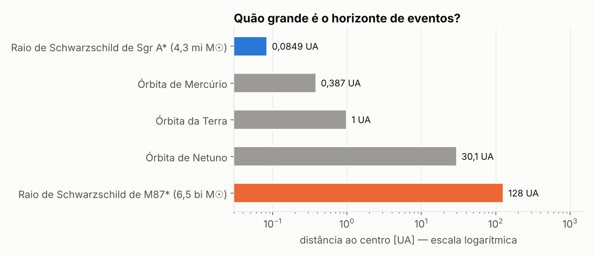
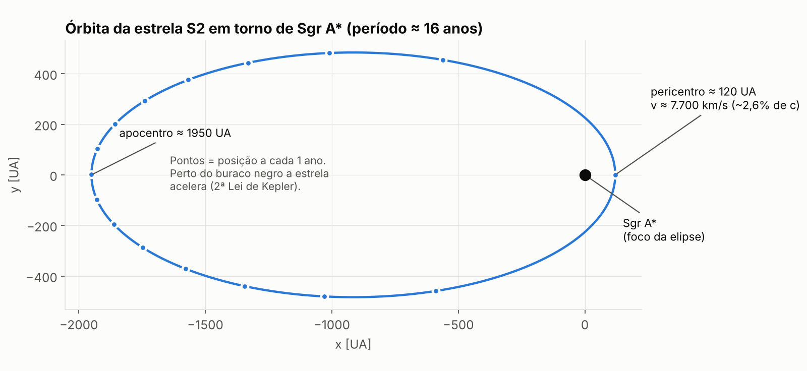
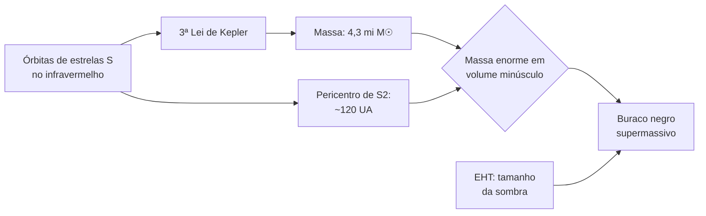
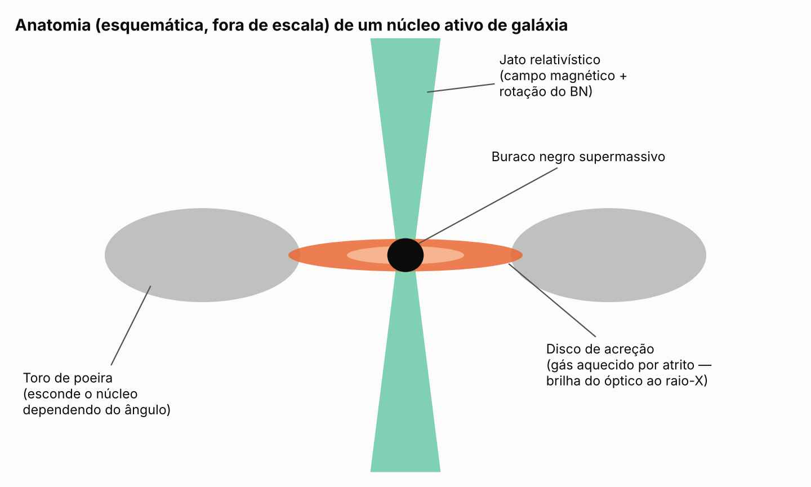
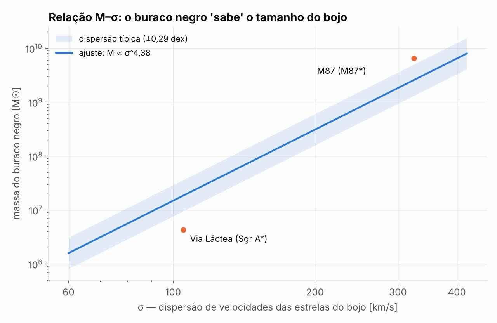

# 🕳️ Buracos negros no centro das galáxias

> **LUNA — Grupo de Astronomia · UFSC Araranguá**
> Ciclo _Galáxias_ · Pesquisa: Gustavo Rech Costa

---

## Resumo

Galáxias massivas abrigam, em seus núcleos, buracos negros com **10⁶ a 10¹⁰ massas solares**, os chamados buracos negros supermassivos (SMBH, _supermassive black holes_). Este material reúne as evidências de que eles existem, a forma como suas massas são medidas, o modo como se tornam visíveis quando acretam matéria e a relação observada entre a massa do buraco negro e a galáxia hospedeira. O caso da Via Láctea (**Sagittarius A\***) é tratado em detalhe, com os cálculos que permitem reproduzir sua massa a partir da órbita de uma única estrela.

**Sumário**

1. [Onde estão e quão grandes são](#1-onde-estão-e-quão-grandes-são)
2. [Sgr A\*: pesando o buraco negro da Via Láctea](#2-sgr-a-pesando-o-buraco-negro-da-via-láctea)
3. [Imagens do Event Horizon Telescope](#3-imagens-do-event-horizon-telescope)
4. [Como se mede a massa em outras galáxias](#4-como-se-mede-a-massa-em-outras-galáxias)
5. [Núcleos ativos: quando o buraco negro acreta](#5-núcleos-ativos-quando-o-buraco-negro-acreta)
6. [Coevolução: a relação M–σ](#6-coevolução-a-relação-mσ)
7. [Problema em aberto: a origem](#7-problema-em-aberto-a-origem)
8. [Equívocos comuns](#8-equívocos-comuns)
9. [Referências](#referências)

---

## 1. Onde estão e quão grandes são

Praticamente toda galáxia com bojo estelar significativo hospeda um SMBH no centro dinâmico. Os dois mais bem estudados:

|                                       | **Sgr A\***                                      | **M87\***                                    |
| ------------------------------------- | ------------------------------------------------ | -------------------------------------------- |
| Galáxia hospedeira                    | Via Láctea (espiral barrada)                     | M87 (elíptica gigante, aglomerado de Virgem) |
| Distância                             | ~27 mil anos-luz (8,28 kpc)                      | ~55 milhões de anos-luz (16,8 Mpc)           |
| Massa                                 | 4,3 × 10⁶ M☉                                     | 6,5 × 10⁹ M☉                                 |
| Raio de Schwarzschild $R_s = 2GM/c^2$ | 1,27 × 10¹⁰ m ≈ **0,085 UA** (~18 raios solares) | 1,9 × 10¹³ m ≈ **128 UA**                    |
| Estado                                | Quiescente (acreção muito baixa)                 | Ativo, com jato de milhares de anos-luz      |

> M☉ = massa do Sol ≈ 2 × 10³⁰ kg · 1 UA = distância Terra–Sol ≈ 1,5 × 10¹¹ m

O horizonte de Sgr A\* caberia dentro da órbita de Mercúrio; o de M87\* é cerca de quatro vezes maior que a órbita de Netuno.

Como $R_s \propto M$, a densidade média dentro do horizonte, $\rho = M / (\tfrac{4}{3}\pi R_s^3)$, cai com $1/M^2$: ~10⁶ kg/m³ para Sgr A\* e **~0,4 kg/m³ para M87\*, menos que a densidade do ar**. A conta é só de ordem de grandeza (o interior não é matéria distribuída), mas mostra que _supermassivo_ não implica _superdenso_.

---

## 2. Sgr A\*: pesando o buraco negro da Via Láctea

O centro galáctico é invisível em luz visível por causa da poeira interestelar, mas transparente no **infravermelho**. Desde o início dos anos 1990, dois grupos (Reinhard Genzel, com telescópios do ESO, e Andrea Ghez, com o Keck) acompanham as posições das estrelas que orbitam a fonte de rádio compacta Sgr A\*, as chamadas **estrelas S**.

A mais usada é a **S2**: período de ~16 anos e órbita muito excêntrica.

_Esquerda: imagem infravermelha do centro galáctico (VLT/NACO). Direita: posições medidas de S2 de 1992 a 2002; Sgr A\* ocupa um dos focos da elipse. Crédito: ESO._

### 2.1 Massa pela 3ª Lei de Kepler

Para um corpo de massa desprezível orbitando uma massa $M$:

$$
T^2 = \frac{4\pi^2}{G M}\, a^3
$$

Em unidades de **anos**, **UA** e **massas solares**, as constantes se cancelam (a órbita da Terra fornece $T = 1$, $a = 1$, $M = 1$):

$$
\boxed{M\,[M_\odot] = \frac{a^3\,[\text{UA}^3]}{T^2\,[\text{anos}^2]}}
$$

Parâmetros de S2:

- semieixo maior angular ≈ 0,125″; à distância de 8,28 kpc ⇒ $a \approx 0{,}125 \times 8280 \approx 1035$ UA _(por definição de parsec, 1″ vista a 1 pc corresponde a 1 UA)_
- período $T \approx 16{,}05$ anos
- excentricidade $e \approx 0{,}884$

$$
M \approx \frac{1035^3}{16{,}05^2} \approx \frac{1{,}11 \times 10^9}{257{,}6} \approx \mathbf{4{,}3 \times 10^6\ M_\odot}
$$

O resultado coincide com o valor publicado pela colaboração GRAVITY a partir de múltiplas órbitas: **4,30 × 10⁶ M☉, com precisão de ~0,25%**.

### 2.2 Por que só um buraco negro explica

- **Pericentro:** $a(1-e) = 1035 \times 0{,}116 \approx$ **120 UA**, cerca de 1400 vezes o raio de Schwarzschild.
- **Velocidade no pericentro** (equação _vis-viva_):

$$
v = \sqrt{GM\left(\frac{2}{r} - \frac{1}{a}\right)} \approx 7{,}7 \times 10^3\ \text{km/s} \approx 2{,}6\%\ \text{de}\ c
$$

- **Massa estendida:** os dados limitam qualquer massa distribuída dentro da órbita de S2 a ~0,1% da massa central. Ou seja, os 4,3 milhões de massas solares estão concentrados num volume menor que o Sistema Solar e não emitem a luz que 4 milhões de estrelas emitiriam. Aglomerados densos de estrelas ou de remanescentes estelares nesse volume seriam dinamicamente instáveis em tempos curtos.

### 2.3 Testes de Relatividade Geral

A proximidade de S2 ao buraco negro tornou mensuráveis dois efeitos relativísticos:

| Efeito                            | O que é                                                      | Resultado                                                          |
| --------------------------------- | ------------------------------------------------------------ | ------------------------------------------------------------------ |
| Redshift gravitacional (2018)     | A luz da estrela perde energia ao sair do poço gravitacional | Detectado, compatível com RG                                       |
| Precessão de Schwarzschild (2020) | O eixo da elipse gira a cada volta                           | ~12′ (minutos de arco) por órbita, compatível com RG, a ~7σ (2022) |

Esses trabalhos renderam o **Prêmio Nobel de Física de 2020** a Genzel e Ghez, compartilhado com Roger Penrose.

---

## 3. Imagens do Event Horizon Telescope

O **EHT** combina radiotelescópios de vários continentes por **interferometria de base muito longa (VLBI)**, observando em λ = 1,3 mm. A resolução angular é da ordem de

$$
\theta \approx \frac{\lambda}{D_{base}} \approx \frac{1{,}3 \times 10^{-3}\ \text{m}}{1{,}27 \times 10^{7}\ \text{m}} \approx 10^{-10}\ \text{rad} \approx 20\ \mu\text{as}
$$

que é a escala necessária para resolver a vizinhança do horizonte desses dois objetos.

|                M87\* (publicada em 2019)                |                   Sgr A\* (publicada em 2022)                    |
| :-----------------------------------------------------: | :--------------------------------------------------------------: |
|  |  |

_Crédito: EHT Collaboration. Cores falsas: o brilho representa intensidade em rádio._

O anel é emissão de gás quente com trajetórias de luz curvadas pela gravidade; a região central escura é a **sombra**, cujo raio (~2,6 $R_s$) é maior que o do horizonte.

### 3.1 Previsão × medida

Para um buraco negro sem rotação, o diâmetro da sombra é $\sqrt{27}\,R_s$, e o tamanho angular visto da Terra é

$$
\theta_{sombra} \approx \frac{\sqrt{27}\, R_s}{D} = \frac{2\sqrt{27}\, GM}{c^2 D}
$$

|         | Massa (medida independentemente) | Distância | Diâmetro previsto | Diâmetro do anel medido |
| ------- | -------------------------------- | --------- | ----------------- | ----------------------- |
| Sgr A\* | 4,3 × 10⁶ M☉ (órbitas estelares) | 8,28 kpc  | ≈ 53 μas          | **51,8 ± 2,3 μas**      |
| M87\*   | 6,5 × 10⁹ M☉                     | 16,8 Mpc  | ≈ 40 μas          | **≈ 42 μas**            |

> μas = microssegundo de arco (10⁻⁶ ″). Cerca de 50 μas equivale ao tamanho aparente de uma rosquinha na superfície da Lua, vista da Terra.

A massa obtida por dinâmica estelar no infravermelho e o tamanho da sombra em rádio são medidas **independentes** e concordam dentro das incertezas.

A imagem de Sgr A\* foi mais difícil de obter que a de M87\*, apesar de o objeto estar ~2000 vezes mais perto: com massa ~1500 vezes menor, o gás ao redor completa uma órbita em **minutos** (em M87\*, em dias), e a estrutura muda durante a própria observação.

---

## 4. Como se mede a massa em outras galáxias

Fora da Via Láctea não é possível seguir estrelas individuais em órbita. Os métodos usados:

| Método                          | Princípio                                                                                                                           | Aplicação típica                                                       |
| ------------------------------- | ----------------------------------------------------------------------------------------------------------------------------------- | ---------------------------------------------------------------------- |
| Dinâmica estelar                | Modelar a distribuição de velocidades das estrelas no núcleo                                                                        | Galáxias próximas (≲ 100 Mpc)                                          |
| Dinâmica de gás                 | Velocidade de rotação de um disco de gás ionizado ou molecular                                                                      | Galáxias com discos nucleares                                          |
| **Masers de água**              | Pontos de emissão maser num disco em rotação kepleriana, medidos por VLBI                                                           | NGC 4258: ~4 × 10⁷ M☉, uma das massas mais precisas fora da Via Láctea |
| **Mapeamento por reverberação** | Atraso entre variações do disco e da região de linhas largas fornece o raio $R$; a largura da linha fornece $v$; $M \sim R v^2 / G$ | Núcleos ativos, inclusive distantes                                    |
| Imagem da sombra (EHT)          | Tamanho angular ∝ $M/D$                                                                                                             | Só Sgr A\* e M87\* até agora                                           |

Todos se reduzem, no fim, à mesma física: **velocidade e raio de uma órbita determinam a massa interna**.

---

## 5. Núcleos ativos: quando o buraco negro acreta

Quando há gás disponível no núcleo, ele não cai diretamente no buraco negro: precisa perder **momento angular**, o que forma um **disco de acreção**. O atrito viscoso aquece o disco, que irradia do óptico aos raios X. Um núcleo nesse estado é um **AGN** (_Active Galactic Nucleus_); os mais luminosos são os **quasares**, capazes de superar em brilho a galáxia inteira.

### 5.1 Eficiência energética

A luminosidade produzida pela matéria que cai é

$$
L = \eta\, \dot{M}\, c^2
$$

onde $\eta$ é a fração da energia de repouso convertida em radiação:

| Processo                    | $\eta$                                               |
| --------------------------- | ---------------------------------------------------- |
| Combustão química           | ~10⁻¹⁰                                               |
| Fusão nuclear (H → He)      | ~0,007                                               |
| **Acreção em buraco negro** | **~0,06 a 0,4** (depende da rotação do buraco negro) |

A acreção é de **10 a 50 vezes mais eficiente que a fusão nuclear**, o que explica por que um quasar que consome poucas massas solares por ano supera em brilho trilhões de estrelas.

Existe um teto: o **limite de Eddington**, luminosidade em que a pressão de radiação sobre o gás iguala a atração gravitacional. Para Sgr A\* ele vale ~5 × 10³⁷ W, e a luminosidade real é uma fração minúscula disso: o buraco negro da Via Láctea está, hoje, praticamente "em jejum".

O modelo unificado de AGN propõe que diferentes classes de núcleos ativos (quasares, galáxias Seyfert tipo 1 e 2, blazares) são o mesmo sistema visto de **ângulos diferentes**: o toro de poeira esconde ou expõe o disco, e um jato apontado para a Terra produz um blazar.

---

## 6. Coevolução: a relação M–σ

Em 2000, dois grupos (Ferrarese & Merritt; Gebhardt et al.) mostraram que a massa do SMBH se correlaciona fortemente com a **dispersão de velocidades σ** das estrelas do bojo da galáxia. Ajuste de Kormendy & Ho (2013):

$$
\frac{M_{BH}}{10^9\,M_\odot} \approx 0{,}31 \left(\frac{\sigma}{200\ \text{km/s}}\right)^{4{,}38}
$$

com dispersão intrínseca de ~0,3 dex. Em bojos clássicos e elípticas, a massa do buraco negro também corresponde a ~0,5% da massa estelar do bojo.

**Por que a correlação é surpreendente.** O raio dentro do qual a gravidade do buraco negro domina sobre a das estrelas é

$$
r_{inf} \approx \frac{G M_{BH}}{\sigma^2} \approx \frac{G \cdot 4{,}3\times10^6 M_\odot}{(100\ \text{km/s})^2} \approx 2\ \text{pc} \approx 6\ \text{anos-luz}
$$

numa galáxia com ~100 mil anos-luz de diâmetro. O buraco negro não tem alcance gravitacional para moldar o bojo, e mesmo assim as duas grandezas crescem juntas.

**Explicação mais aceita: feedback.** Na fase ativa, a energia liberada (radiação, ventos, jatos) aquece e expulsa o gás da galáxia, interrompendo a formação estelar e cortando o próprio suprimento do buraco negro. É uma realimentação negativa que acopla o crescimento dos dois.

A Via Láctea fica **abaixo** da relação: seu bojo é dominado por uma barra (pseudobojo), e galáxias desse tipo tendem a não seguir a correlação dos bojos clássicos.

---

## 7. Problema em aberto: a origem

O telescópio espacial **James Webb (JWST)** tem detectado SMBHs ativos **400 a 500 milhões de anos após o Big Bang**, por exemplo na galáxia GN-z11 (z ≈ 10,6, ~1,6 × 10⁶ M☉) e, em 2025, em CAPERS-LRD-z9. Esses objetos tensionam os modelos de crescimento.

### 7.1 Tempo mínimo de crescimento

Acretando continuamente no limite de Eddington, a massa cresce exponencialmente, com tempo característico (tempo de Salpeter) $t_S \approx 50$ milhões de anos para $\eta \approx 0{,}1$:

$$
M(t) = M_0\, e^{t/t_S}
\quad\Rightarrow\quad
t = t_S \ln\!\left(\frac{M}{M_0}\right)
$$

De uma semente de 100 M☉ (remanescente de estrela) até 10⁹ M☉:

$$
t \approx 50\ \text{Myr} \times \ln(10^7) \approx 50 \times 16 \approx 800\ \text{milhões de anos}
$$

E isso supondo acreção máxima ininterrupta, o que não é realista. Ainda assim, há quasares com ~10⁹ M☉ observados quando o Universo tinha ~700 milhões de anos.

| Hipótese                | Ideia                                                | Implicação                                                                       |
| ----------------------- | ---------------------------------------------------- | -------------------------------------------------------------------------------- |
| Sementes leves          | Remanescentes das primeiras estrelas (~10² M☉)       | Exigem crescimento contínuo no limite máximo                                     |
| Sementes pesadas        | Colapso direto de nuvens de gás em BNs de 10⁴–10⁵ M☉ | Economizam ~5–7 tempos de _e-folding_ (~250–350 Myr); exigem condições especiais |
| Acreção super-Eddington | Fases curtas acima do limite, em discos espessos     | Possível teoricamente, difícil de confirmar observacionalmente                   |

---

## 8. Equívocos comuns

| Afirmação                                       | O que os dados mostram                                                                                          |
| ----------------------------------------------- | --------------------------------------------------------------------------------------------------------------- |
| "O buraco negro central mantém a galáxia unida" | Sgr A\* tem ~0,0004% da massa da Via Láctea. A rotação galáctica é dominada por estrelas, gás e matéria escura. |
| "Ele vai engolir a galáxia"                     | Fora do raio de influência (~2 pc), a atração é a de qualquer massa equivalente. O Sistema Solar está a 8 kpc.  |
| "A imagem do EHT mostra o buraco negro"         | Mostra a sombra e o gás iluminado ao redor; o horizonte não emite.                                              |
| "Matéria cai direto no buraco negro"            | Precisa perder momento angular; por isso forma disco de acreção.                                                |
| "Supermassivo significa superdenso"             | A densidade média dentro do horizonte cai com $1/M^2$.                                                          |

---

## Referências

**Artigos científicos**

1. GRAVITY Collaboration (2020). _Detection of the Schwarzschild precession in the orbit of the star S2 near the Galactic centre massive black hole._ **A&A 636, L5.** [arXiv:2004.07187](https://arxiv.org/abs/2004.07187)
2. GRAVITY Collaboration (2022). _The mass distribution in the Galactic Centre from interferometric astrometry of multiple stellar orbits._ **A&A 657, A82.** [arXiv:2112.07478](https://arxiv.org/abs/2112.07478)
3. Genzel, R., Eisenhauer, F. & Gillessen, S. (2010). _The Galactic Center massive black hole and nuclear star cluster._ **Rev. Mod. Phys. 82, 3121.**
4. Event Horizon Telescope Collaboration (2019). _First M87 Event Horizon Telescope Results. I. The Shadow of the Supermassive Black Hole._ **ApJL 875, L1.**
5. Event Horizon Telescope Collaboration (2022). _First Sagittarius A\* Event Horizon Telescope Results. I & IV._ **ApJL 930, L12 e L15.**
6. Ferrarese, L. & Merritt, D. (2000). **ApJ 539, L9**; Gebhardt, K. et al. (2000). **ApJ 539, L13.** (descoberta da relação M–σ)
7. Kormendy, J. & Ho, L. C. (2013). _Coevolution (Or Not) of Supermassive Black Holes and Host Galaxies._ **ARA&A 51, 511.** [arXiv:1304.7762](https://arxiv.org/abs/1304.7762)
8. Maiolino, R. et al. (2024). _A small and vigorous black hole in the early Universe._ **Nature 627, 59.**

**Imagens**

- ESO: [Buraco negro do centro galáctico](https://www.eso.org/public/science/gc/) · [Imagem de Sgr A\*](https://www.eso.org/public/images/eso2208-eht-mwa/) · [Órbita de S2](https://www.eso.org/public/images/eso0226c/) · [Imagem de M87\*](https://www.eso.org/public/images/eso1907a/)
- [Event Horizon Telescope](https://eventhorizontelescope.org/)
- [Prêmio Nobel de Física 2020](https://www.nobelprize.org/prizes/physics/2020/summary/)
- Oliveira Filho, K. S. & Saraiva, M. F. O. _Astronomia e Astrofísica_ (UFRGS): [astro.if.ufrgs.br](http://astro.if.ufrgs.br/)s
