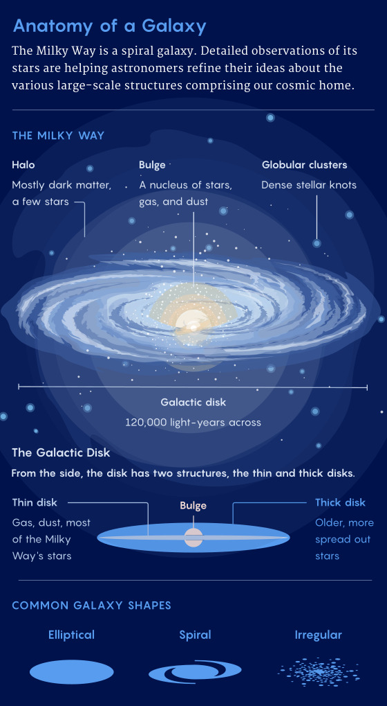
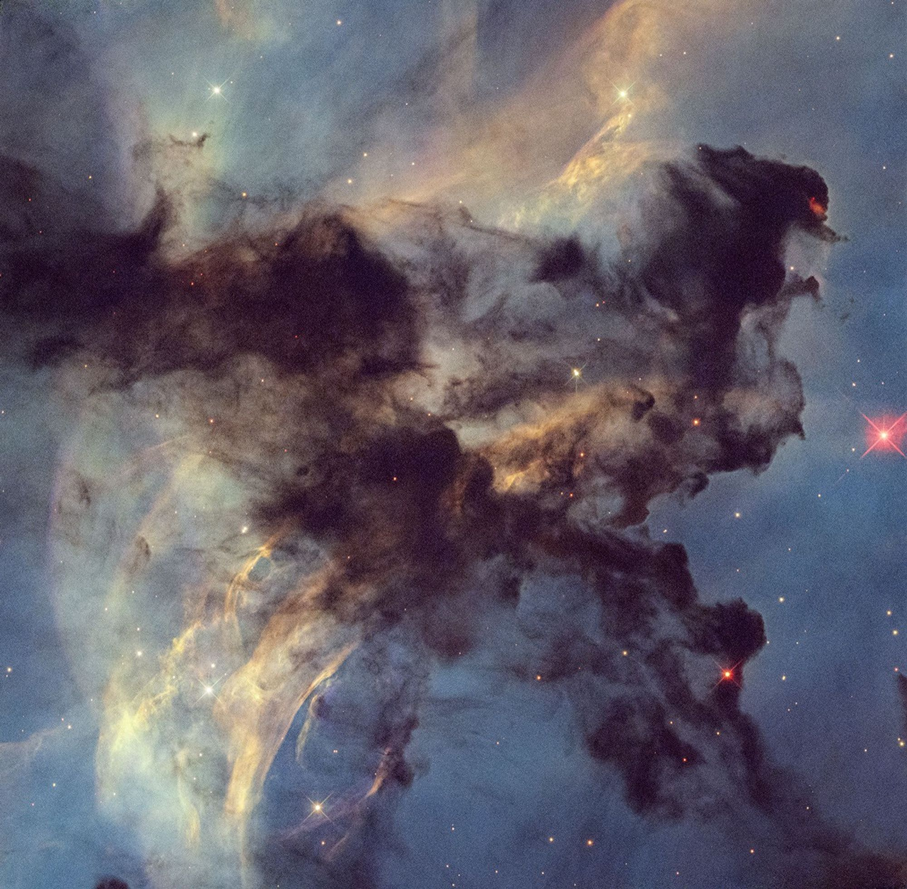

# O que são Galáxias?
Galáxias são sistemas astronômicos compostos por estrelas, gases, planetas, asteroides e poeira cósmica, unidos pela atração gravitacional.

# Estrutura das Galáxias
A estrutura de uma galáxia pode ser divida em três partes: um núcleo ou bojo, um disco e um halo

* **Núcleo**: É a região central da galáxia, onde há uma grande concentração de estrelas. Em algumas galáxias, pode abrigar um buraco negro supermassivo. Quando há intensa atividade nessa região, grandes quantidades de energia e radiação podem ser emitidas, tornando o centro muito brilhante.
* **Disco**: É a região achatada da galáxia que concentra grande parte das estrelas jovens, além de gás e poeira cósmica. Nas galáxias espirais, o disco contém os braços espirais, regiões onde há grande concentração de gás e poeira, favorecendo a formação de novas estrelas.
* **Halo**: É uma região extensa e aproximadamente esférica que envolve o disco e a região central da galáxia. Contém principalmente estrelas antigas e aglomerados globulares, que são grupos de estrelas unidos pela gravidade. Além disso, abriga uma grande quantidade de matéria escura, cuja gravidade influencia o movimento das estrelas e contribui significativamente para a massa total da galáxia.

# Composição das Galáxias
* **Estrelas**: Estrela é um grande astro, geralmente de forma esférica, que produz sua própria luz e se mantém unido pela força da gravidade.
* **Sistemas planetários**: Sistema planetário é um conjunto formado por uma estrela e todos os corpos celestes que giram ao seu redor.
* **Nebulosas**: Nebulosas são grandes nuvens de poeira e gases presentes no espaço, formadas, em alguns casos, a partir dos restos de estrelas.
  Elas são fundamentais para o ciclo de vida das estrelas, funcionando como berçários espaciais, onde novas estrelas se formam.
  
  
  
* **Matéria escura**: Matéria escura é uma forma de matéria cuja natureza ainda é desconhecida, mas que exerce influência gravitacional sobre as galáxias e o Universo.
* **Energia escura**: A energia escura é uma forma hipotética de energia que permeia todo o espaço e atua com pressão negativa, sendo a força responsável pela expansão acelerada do universo
