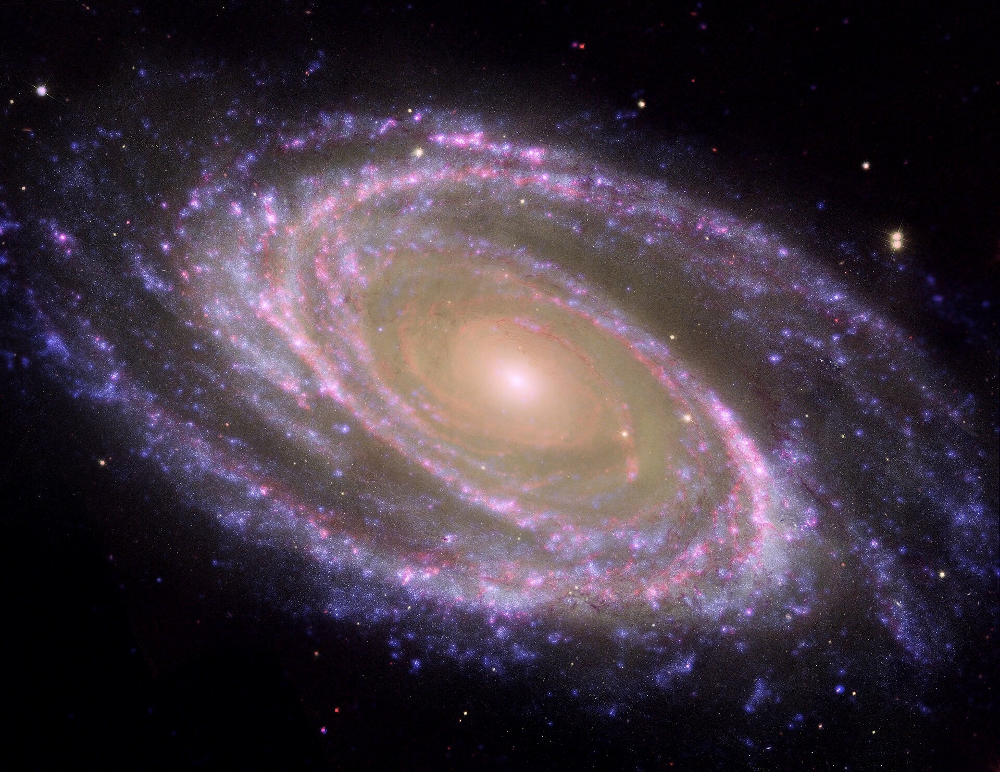
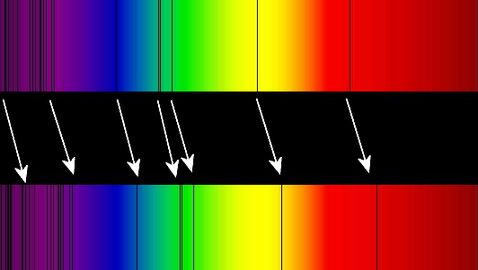
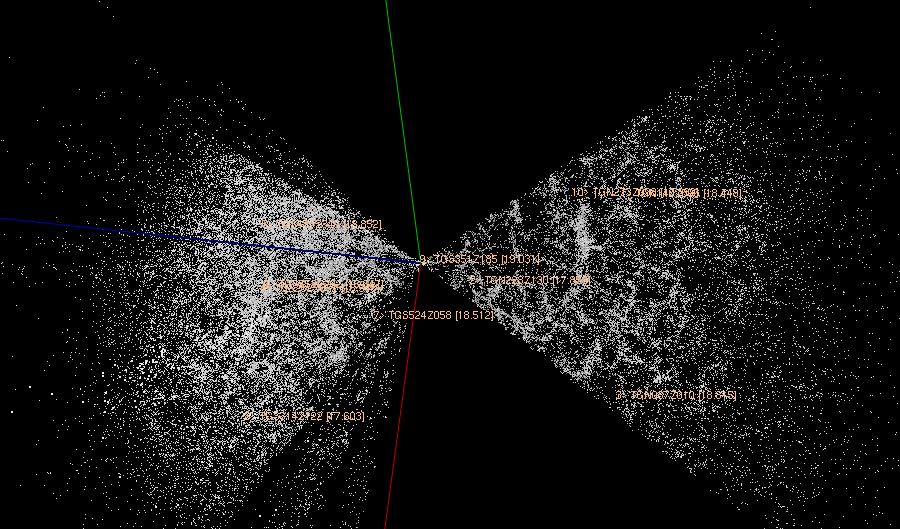

# Observação e Análise de Dados de Galáxias

## 📋 Sumário

1. [Introdução](#1-introdução)
2. [Observação Multicomprimento de Onda](#2-observação-multicomprimento-de-onda)
3. [Técnicas Fundamentais de Coleta de Dados](#3-técnicas-fundamentais-de-coleta-de-dados)
   * [Fotometria](#31-fotometria)
   * [Espectroscopia e Redshift](#32-espectroscopia-e-redshift)
4. [Formatos de Dados e Grandes Levantamentos (Surveys)](#4-formatos-de-dados-e-grandes-levantamentos-surveys)
5. [Análise de Dados Moderna e Ciência de Dados](#5-análise-de-dados-moderna-e-ciência-de-dados)
6. [Referências](#6-referências)

## 1. Introdução

O estudo das galáxias depende inteiramente da nossa capacidade de coletar, processar e interpretar a radiação eletromagnética que viaja milhões ou bilhões de anos-luz até chegar aos nossos detectores. Diferente de outras ciências, a astrofísica extragaláctica é uma ciência puramente observacional: não podemos interagir fisicamente com uma galáxia em laboratório, mas podemos extrair suas propriedades físicas (como massa, composição química, taxa de formação estelar, distância e cinemática) analisando os fótons que ela emite.

## 2. Observação Multicomprimento de Onda

As galáxias são sistemas complexos compostos por estrelas de diferentes idades, gás interestelar, poeira cósmica, matéria escura e, frequentemente, um buraco negro supermassivo central. Cada um desses componentes emite radiação em faixas específicas do espectro eletromagnético:

- **Rádio (ex: ALMA, VLA):** Mapeia o gás hidrogênio neutro ($H\text{ I}$ na linha de $21\text{ cm}$) e nuvens moleculares frias, essenciais para entender o reservatório de combustível para novas estrelas.
- **Infravermelho (ex: JWST, Spitzer):** Atravessa a poeira interestelar que bloqueia a luz visível, revelando berçários estelares ocultos e galáxias extremamente distantes (alto *redshift*).
- **Óptico / Luz Visível (ex: Hubble, VLT):** Mostra a distribuição da população estelar principal e a morfologia clássica da galáxia.
- **Ultravioleta (ex: GALEX):** Rastreia estrelas jovens, massivas e quentes (tipos O e B), sendo um excelente indicador de formação estelar recente.
- **Raios-X e Gama (ex: Chandra, XMM-Newton):** Detectam gás extremamente quente em aglomerados de galáxias e a acreção violenta de matéria ao redor de Núcleos Galácticos Ativos (AGNs).

  
   
  <em>Figura 1: A galáxia espiral Messier 81 (M81) observada em múltiplos comprimentos de onda (Infravermelho pelo Spitzer, Ultravioleta pelo GALEX e Óptico pelo Hubble), destacando diferentes estruturas físicas. Fonte: NASA/JPL-Caltech/ESA/Harvard-Smithsonian CfA [6].</em>

## 3. Técnicas Fundamentais de Coleta de Dados

Na observação astronômica, a análise de dados divide-se tradicionalmente em duas abordagens principais: **Fotometria** e **Espectroscopia** (e sua união moderna, a **Espectroscopia de Campo Integral, ou IFS**).

### 3.1. Fotometria

A fotometria consiste em medir a intensidade da luz (fluxo) de uma galáxia através de filtros de banda larga ou estreita (como o sistema $u, g, r, i, z$).

A partir dos dados fotométricos, os astrônomos realizam:

- **Índices de Cor:** A diferença de magnitude entre dois filtros (ex: $g - r$) indica a temperatura média das estrelas e a idade da população estelar (galáxias elípticas tendem a ser "vermelhas e mortas", enquanto espirais são "azuis e ativas").
- **Ajuste de Perfil de Brilho Superficial:** Modela-se como a luz decai do centro para as bordas usando a **Lei de Sérsic**:

$$
I(R) = I_e \exp \left( -b_n \left[ \left( \frac{R}{R_e} \right)^{\frac{1}{n}} - 1 \right] \right)
$$

Onde $R_e$ é o raio efetivo (que contém metade da luz total), $I_e$ é a intensidade nesse raio, e $n$ é o **índice de Sérsic** (geralmente $n \approx 1$ para discos espirais e $n \approx 4$ para galáxias elípticas).

### 3.2. Espectroscopia e Redshift

A espectroscopia dispersa a luz da galáxia em função do comprimento de onda, revelando linhas de absorção (causadas por atmosferas estelares) e linhas de emissão (causadas por gás ionizado, como $H\alpha$ e $[O\text{ III}]$).

  
   
  <em>Figura 2: Representação do deslocamento das linhas espectrais de absorção para o vermelho (Redshift) em um superaglomerado de galáxias distantes (espectro inferior) comparado ao espectro de referência do Sol (espectro superior). Fonte: Georg Wiora / Wikimedia Commons [7].</em>

A análise espectral permite calcular diretamente o **Redshift ($z$)** (desvio para o vermelho):

$$
z = \frac{\lambda_{\text{observado}} - \lambda_{\text{emitido}}}{\lambda_{\text{emitido}}}
$$

Para baixos *redshifts*, a velocidade de recessão da galáxia é dada por $v \approx c \cdot z$ (onde $c$ é a velocidade da luz). Pela **Lei de Hubble-Lemaître**, determinamos a distância ($d$) até a galáxia:

$$
v = H_0 \cdot d
$$

Onde $H_0$ é a Constante de Hubble ($\approx 70\text{ km s}^{-1}\text{ Mpc}^{-1}$). Além da distância, o alargamento das linhas espectrais por efeito Doppler permite medir a velocidade de rotação da galáxia e estimar a massa do seu halo de **matéria escura**.

## 4. Formatos de Dados e Grandes Levantamentos (Surveys)

Diferente de fotos comuns (`.jpg` ou `.png`), os dados astronômicos profissionais são armazenados no formato **FITS (*Flexible Image Transport System*)**. Um arquivo FITS contém:

1. **Cabeçalho (Header):** Metadados detalhados (coordenadas celestes, tempo de exposição, telescópio, filtros, data de observação).
2. **Matriz de Dados:** Valores numéricos reais de contagem de fótons em cada pixel ou cubos de dados tridimensionais $(x, y, \lambda)$.

| Levantamento / Telescópio | Faixa Espectral | Tipo de Dados Principal | Impacto na Ciência de Galáxias |
| ----- | ----- | ----- | ----- |
| **SDSS / 2dFGRS** | Óptico / Infravermelho Próximo | Fotometria e Espectros 1D/IFS | Mapeou milhões de galáxias e a estrutura em grande escala do Universo. |
| **JWST** (*James Webb*) | Infravermelho | Imagens profundas e Espectroscopia | Descoberta e caracterização das primeiras galáxias formadas após o Big Bang ($z > 10$). |
| **Gaia** (ESA) | Óptico | Astrometria e Fotometria | Mapeamento cinemático preciso da Via Láctea e galáxias satélites locais. |
| **Vera C. Rubin (LSST)** | Óptico | Fotometria em série temporal | Gerará $\sim 20\text{ TB}$ de dados por noite, catalogando bilhões de galáxias. |

  
   
  <em>Figura 3: Mapa da distribuição em grande escala de galáxias obtido através da análise de dados de redshift de levantamentos espectroscópicos (2dFGRS). Cada ponto representa uma galáxia. Fonte: Colless et al. / 2dF Galaxy Redshift Survey [8].</em>

## 5. Análise de Dados Moderna e Ciência de Dados

Com o volume massivo de dados gerados pelos telescópios modernos (Era do *Big Data* na Astronomia), a análise manual tornou-se impossível. O fluxo de trabalho (*pipeline*) de um astrofísico de dados envolve:

1. **Ajuste de Distribuição Espectral de Energia (SED Fitting):** Softwares como *CIGALE* ou *Prospector* comparam os dados fotométricos e espectroscópicos de uma galáxia com milhões de modelos teóricos para estimar a Massa Estelar ($M_\star$), a Taxa de Formação Estelar ($SFR$) e a metalicidade.
2. **Ecossistema Python na Astronomia:** Uso extensivo de bibliotecas de código aberto, especialmente o pacote **`Astropy`** (para manipulação de coordenadas, cosmologia e leitura de arquivos FITS) e **`SciPy`** para ajustes de curvas.
3. **Ciência Cidadã e Machine Learning:** Projetos como o *Galaxy Zoo* utilizaram voluntários humanos para classificar milhões de galáxias; hoje, esses rótulos treinam **Redes Neurais Convolucionais (CNNs)** capazes de classificar morfologias galácticas e detectar fusões em milissegundos.

## 6. Referências

1. **KEEL, W. C.** *The Road to Galaxy Formation*. 2. ed. Berlin: Springer-Verlag, 2007.
2. **SPARKE, L. S.; GALLAGHER, J. S.** *Galaxies in the Universe: An Introduction*. 2. ed. Cambridge: Cambridge University Press, 2007.
3. **SLOAN DIGITAL SKY SURVEY (SDSS).** *Voyages: Galaxies and Spectrophotometry*. Disponível em: <https://www.sdss.org/>. Acesso em: out. 2026.
4. **ASTROPY COLLABORATION.** *The Astropy Project: Sustaining and Growing a Community-oriented Open-source Project and the Latest Major Release (v5.0) of the Core Package*. The Astrophysical Journal, v. 935, n. 2, p. 167, 2022.
5. **NASA / ESA.** *James Webb Space Telescope Documentation (JDox)*. Space Telescope Science Institute (STScI). Disponível em: <https://jwst-docs.stsci.edu/>. Acesso em: out. 2026.
6. **NASA / JPL-CALTECH / ESA / HARVARD-SMITHSONIAN CFA.** *Messier 81 Spanning the Spectrum (Spitzer, Hubble, GALEX)*. 2007. Disponível em: <https://commons.wikimedia.org/wiki/File:Sig07-009.jpg>. Acesso em: out. 2026.
7. **WIORA, G.** *Redshift of spectral lines in the optical spectrum of a supercluster of distant galaxies (BASOWL)*. Wikimedia Commons, 2006. Disponível em: <https://commons.wikimedia.org/wiki/File:Redshift_horizontal.png>. Acesso em: out. 2026.
8. **COLLESS, M. et al.** *The 2dF Galaxy Redshift Survey: spectra and redshifts*. Monthly Notices of the Royal Astronomical Society (MNRAS), v. 328, n. 4, p. 1039-1063, 2001. Imagem disponível em: <https://commons.wikimedia.org/wiki/File:2dfgrs.png>. Acesso em: out. 2026.
